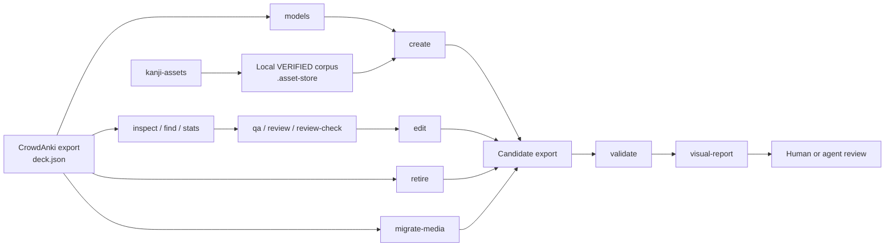

<div align="center">

# Anki Deck Toolkit — Tools for Anki and CrowdAnki JSON

[Русский](README.md) · **English** · [简体中文](README.zh-CN.md)

**Rust CLI tools for inspecting and validating CrowdAnki JSON exports, making targeted edits, and visually comparing versions.**

[](https://github.com/AliceLiddell01/anki-deck-toolkit/actions/workflows/ci.yml)


[](LICENSE)
[](https://deepwiki.com/AliceLiddell01/anki-deck-toolkit)

A toolkit for Anki deck maintainers and developers: inspect exports, validate structure and media references, review note quality, perform safe edits with `dry-run`, create notes using existing note models, and generate HTML before/after reports. The tools do not call LLM APIs but support an auditable workflow with external AI agents.

**This is not a catalog of ready-made decks.** Users' CrowdAnki exports, media files, and local asset corpora are not published through Git.

[Who it's for](#who-its-for) · [Features](#features) · [How it works](#how-it-works) · [Quick start](#quick-start) · [Tools](#tools) · [Repository layout](#repository-layout) · [License](#license)

</div>

---

## Who it's for

- **Maintainers of large Anki decks stored as CrowdAnki JSON:** inspect and validate exports without manually reading `deck.json`, make targeted edits, and visually inspect the results.
- **Tool developers and AI-agent users:** reproducible CLI operations, invariant checks, default `dry-run` behavior for mutating commands, and explicit application of changes.

## Why this repository exists

A typical CrowdAnki export is a large JSON file that is difficult to inspect, compare, or edit safely by hand. This repository provides deterministic tools for working with such exports while keeping the actual decks as local user data.

The central idea is simple:

> **Decks remain ordinary CrowdAnki data, while everything around them that can be checked and automated is checked and automated.**

This repository contains tooling and agent workflows for local decks, not a Git repository of user decks. It is not tied to a particular deck, JLPT level, note model, or field name. The set of working decks is data, not an architectural contract.

## Features

| Capability | What it does |
|---|---|
| **Inspect an export** | `inspect`, `find`, `stats`, and `models` provide a compact view of its structure without manually reading a multi-megabyte `deck.json`. |
| **Validate integrity** | `validate` checks CrowdAnki structure, identifiers, models, fields, media references, and other invariants. |
| **Quality assurance and content review** | `qa` → `review` → `review-check` turn a large export into compact, verifiable packages for an external agent. |
| **Make targeted changes to cards** | `edit` changes existing field values; `create` adds notes to existing models; `retire` marks a note as retired with a tag; `migrate-media` migrates verified media references to the canonical filename for their resource domain. |
| **See the result** | `visual-report` creates a standalone before/after HTML report with card previews based on the model's actual templates. |
| **Handle kanji images** | `asset-store` and `kanji-assets` retrieve, verify, and store confirmed kanji PNG/GIF files in a program-managed local corpus. |
| **Work safely with agents** | The repository provides routing context and skills so agents follow the owners of each contract instead of guessing the deck's structure. |

## How it works



The tools deliberately separate **structural operations** from **content decisions**. `anki-repo` does not call an LLM API or attempt to judge whether a card's translation or example is good. It finds the relevant data, validates contracts, constrains changes, and supplies concise evidence to an external agent or a human.

## Quick start

You need Linux and the Rust toolchain. The minimum supported Rust version is declared in the root `Cargo.toml`; it is intentionally not duplicated in this documentation.

```bash
git clone https://github.com/AliceLiddell01/anki-deck-toolkit.git
cd anki-deck-toolkit

cargo build --release --workspace
./target/release/anki-repo --help
```

Select a local working deck in `decks/output/<export_name>` and pass the **export directory**, not the path to `deck.json`:

```bash
EXPORT=decks/output/<export_name>

# See what's in the export
./target/release/anki-repo inspect "$EXPORT"

# Validate its structure
./target/release/anki-repo validate "$EXPORT"

# Discover the models and fields that actually exist
./target/release/anki-repo models "$EXPORT"
```

The entire `decks/` directory is ignored by Git, so a fresh clone will not contain its contents. This is normal, not a missing part of the repository. Users supply their own decks. `decks/output/` is a flat list of working decks, with the Anki hierarchy encoded in directory names such as `Words__N5`.

Kanji images can be retrieved and verified with a separate CLI:

```bash
cargo run --locked --bin kanji-assets -- --output json ensure 漢 字
```

Detailed commands and machine-readable contracts are documented in the tool-specific READMEs:

- [`anki-repo` — inspection, QA, constrained changes, and visual reports](tools/anki-repo/README.md)
- [`asset-store` and `kanji-assets` — asset lifecycle and verification](tools/asset-store/README.md)
- [`repository-maintenance` — disk inventory and safe garbage collection](tools/repository-maintenance/README.md)

## Tools

### `anki-repo`

The repository's main toolkit for working with CrowdAnki exports.

**Commands that do not modify the original export:**

`inspect` · `find` · `stats` · `validate` · `qa` · `review` · `review-check` · `models` · `visual-report`

`visual-report` creates a separate report directory but does not modify the exports being compared.

**Commands that can modify an export only with explicit `--apply`:**

- `edit` — changes existing fields in existing notes;
- `create` — adds notes to an existing deck and note model;
- `retire` — adds a retirement tag without physically deleting the note;
- `migrate-media` — rewrites only verified references to a previous filename within the relevant resource domain.

All mutating commands run in `dry-run` mode by default and write only after validation and an explicit `--apply`. `edit` and `retire` modify only `deck.json`. `create` may add only verified files from configured domains to `media/` and include the required `media_files` declarations. `migrate-media` may rewrite proven references in existing notes, place the canonical file, and remove an unused file under its old name after publishing `deck.json`.

[Full `anki-repo` contract →](tools/anki-repo/README.md)

### `repository-maintenance`

A separate Linux/WSL utility that accounts for Cargo `target` directories, project-owned external build caches, and all entries under `/tmp`. `scan` only measures usage; `clean` defaults to `dry-run` and requires `--apply` to write. Unowned and unknown temporary files are reported but never deleted.

[Policy, source audit, commands, and limitations →](tools/repository-maintenance/README.md)

### `asset-store` / `kanji-assets`

A separate program-managed asset store. The current domain-specific CLI handles kanji images:

```text
Yarxi
  ↓
  retrieval
  ↓
  semantic verification
  ├─ VERIFIED  ──→ local verified corpus
  └─ other     ──→ local current-data store / quarantine
```

The verified corpus is trusted local state in the working copy. It contains only confirmed assets and their provenance information; the key files are `manifest.json` and `.owner.json`. Unverified candidates never enter the corpus, and it is not published through Git. Each user has their own corpus, and its absence in a fresh clone is normal. `asset-store` does not scan deck media directories under `decks/` or treat user media directories as data sources.

[Full `asset-store` contract →](tools/asset-store/README.md)

## Creating and visually verifying a card

The standard safe workflow is:

```text
models
  ↓
actual note-model schema
  ↓
create (dry-run)
  ↓
create --apply
  ↓
validate
  ↓
visual-report
  ↓
visual approval
```

For a field explicitly authorized to use `kanji-assets`, `create` may use only images already verified through `asset-store`. The field schema still comes from the actual export: the toolkit does not treat field names such as `Слово` ("Word") or `Ударение` ("Accent") as global contracts.

Authorization can also be configured for `pitch-accent`. In both cases, the rules bind exact note-model UUIDs and field names to a specific domain handler; arbitrary media references remain prohibited. `create` does not create decks or models or assess linguistic content. To modify a media reference in an existing note, use only the narrow `migrate-media` command: it proves the correspondence between an identifier and the former filename, checks consumers in note fields and model templates, and blocks unverified references.

<details>
<summary><strong>Why are modifications so tightly constrained?</strong></summary>

`deck.json` is the canonical source for a deck, so broad "convenience" edits are more dangerous than they may seem.

- Mutating commands use `dry-run` unless `--apply` is provided.
- Existing CrowdAnki/Anki identities are preserved unless there is a separate reason to change them.
- `create` does not create new models, fields, or decks.
- `retire` does not physically delete a note.
- A candidate is parsed and validated again before writing.
- Targeted operations attempt to prove that they changed only authorized data.

The detailed guarantees belong to the [toolkit README](tools/anki-repo/README.md), not this overview.

</details>

<details>
<summary><strong>How does CI work?</strong></summary>

The root Cargo workspace is the single build and verification entry point for Rust code.

```bash
cargo fmt --all --check
cargo clippy --workspace --all-targets --all-features --locked -- -D warnings
cargo test --workspace --all-features --locked
```

GitHub Actions runs the same checks independently of the local environment and also:

- validates script contracts, Agent Skills metadata, and the PR description structure;
- checks the Cargo workspace against its declared MSRV and verifies that `rust-toolchain.toml` matches the actual compiler;
- runs read-only: no job writes back to the repository, publishes artifacts, or performs mutating operations.

CI checks tracked code, documentation, and self-contained fixtures. User data—the entire `decks/` tree and `.asset-store/`—is not included in Git, so CI neither validates personal decks or corpora nor presents their absence in a fresh clone as evidence of a successful test. Instead, CI continuously enforces the boundary: no path inside these areas may be tracked, and the ignore rules must exist (`.github/scripts/check_local_data_untracked.py`). It checks the actual Git index because `.gitignore` does not undo files already staged or tracked, and `git add -f` can bypass ignore rules.

Tests are self-contained and do not use user decks as test data.

</details>

<details>
<summary><strong>What happens to media files?</strong></summary>

The repository has two distinct media ownership boundaries.

**Media belonging to an individual CrowdAnki deck** is owned by that deck and its export.

**Program-managed assets** belong to `asset-store`. It does not read user deck media directories and instead manages its own manifests, checksums, provenance data, temporary quarantine storage, and local verified corpus.

This separation allows trusted assets to be checked and reused without turning a user's `media/` directory into an implicit application database. Only `anki-repo` places verified assets in an export's `media/`: `create` follows explicit domain rules, while `migrate-media` requires proof of the exact identifier/filename match and an inventory of consumers. Migration removes the former filename only after publishing the new `deck.json`; manual edits that bypass the command are not allowed.

</details>

## Repository layout

```text
.
├── decks/                    # user data; entirely ignored by Git
│   ├── input/                # closed area for a future trusted importer
│   └── output/               # flat list of working local decks
├── tools/
│   ├── anki-repo/            # inspection, QA, constrained edits, visual reports
│   ├── asset-store/          # asset library and kanji-assets
│   └── repository-maintenance/ # inventory and safe garbage collection
├── .asset-store/             # trusted local asset store, ignored by Git
├── .agents/
│   └── skills/               # agent workflows
├── .codex/
│   └── context/              # routing and long-lived context
├── .devin/
│   └── wiki.json             # managed DeepWiki configuration
├── .github/
│   └── workflows/            # CI
├── AGENTS.md                 # global agent invariants
├── Cargo.toml                # root Cargo workspace, `edition`, and MSRV
└── Cargo.lock
```

### `decks/` — data, not a contract

User data lives in Git-ignored directories:

- `decks/input/` is a closed area reserved for a future trusted importer. Agents must not read, browse, edit, clean, populate, or use it in tests; the importer does not exist yet.
- `decks/output/<export_name>/` is a flat list of working local decks. The Anki hierarchy is expressed by the directory name itself (`Words__N5`); there are no extra organizer directories, and the export's internal structure (`deck.json`, `media/`, and other standard files) stays intact.

Git ignores all of `decks/`, so no path under it may be tracked—not just the two subdirectories named above. Neither `decks/` nor `.asset-store/` is published through Git. User decks, assets, and private logs remain with the user; ordinary source-code publication through `anki-git-workflow` does not affect them.

The set of working decks can change. New decks may use different models, fields, and structures.

Therefore production code, tests, and CI must not be tied to a particular JLPT level, deck name, model, or field. The tools resolve the actual schema from each CrowdAnki export. The previous `decks/japanese/words/Words__N5/` layout is historical, not contractual: `anki-repo migrate-layout` provides a one-time controlled migration to the flat `decks/output/` layout (dry-run by default).

### Agent context

For AI-assisted workflows, the repository provides a separate map of contract owners:

- [`AGENTS.md`](AGENTS.md) — global invariants;
- [`.codex/context/INDEX.md`](.codex/context/INDEX.md) — routing to domain-specific context;
- [`.agents/skills/`](.agents/skills/) — repository agent procedures.

This README is only a project overview. It does not duplicate the full workflows or architectural contracts owned by those documents.

## Verifying changes

For ordinary development, from the repository root:

```bash
cargo fmt --all --check
cargo clippy --workspace --all-targets --all-features --locked -- -D warnings
cargo test --workspace --all-features --locked
```

For a specific local deck:

```bash
./target/release/anki-repo validate decks/output/<export_name>
```

For a local kanji corpus, if present in the working copy:

```bash
cargo run --quiet --locked -p asset-store --bin kanji-corpus-gate
```

`kanji-corpus-gate` and `pitch-corpus-gate` validate their own local stores; they are not publication prerequisites. Corpora are not published through Git.

## License

The repository's own software, automation, configuration, and project documentation are distributed under the **MIT License**.

The contents of `decks/`, user media, and third-party resources or corpora are not automatically covered by the MIT License. Their original copyright holders' rights or separate terms apply. User data is not published through Git and is not covered by the MIT License.

[Full license text and scope →](LICENSE)

---

<div align="center">

**CrowdAnki remains the data source. The surrounding tools make changes observable, verifiable, and reproducible.**

</div>
