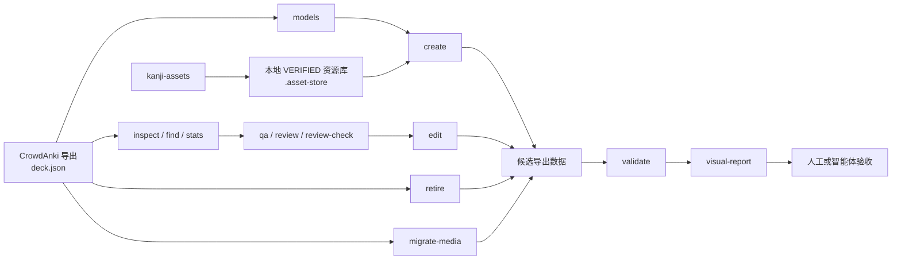

<div align="center">

# Anki Deck Toolkit — Anki 与 CrowdAnki JSON 工具集

[Русский](README.md) · [English](README.en.md) · **简体中文**

**基于 Rust 的命令行工具，用于检查、验证、精确编辑和可视化对比 CrowdAnki JSON 导出数据。**

[](https://github.com/AliceLiddell01/anki-deck-toolkit/actions/workflows/ci.yml)


[](LICENSE)
[](https://deepwiki.com/AliceLiddell01/anki-deck-toolkit)

这套工具面向 Anki 牌组维护者和开发者：查看导出数据、验证结构和媒体引用、检查笔记质量、通过 `dry-run` 安全地进行修改、使用现有笔记类型创建笔记，并生成“修改前 / 修改后”的 HTML 对比报告。工具本身不会调用 LLM API，但支持与外部 AI 智能体配合，形成可核查的工作流程。

**这不是现成牌组的下载目录。** 用户的 CrowdAnki 导出数据、媒体文件及本地资源库不会通过 Git 发布。

[适用人群](#适用人群) · [功能](#功能) · [工作原理](#工作原理) · [快速开始](#快速开始) · [工具](#工具) · [仓库结构](#仓库结构) · [许可证](#许可证)

</div>

---

## 适用人群

- **通过 CrowdAnki JSON 维护大型 Anki 牌组的用户：** 无须手动阅读 `deck.json`，即可检查导出数据、验证其正确性、进行定向修改，并直观确认结果。
- **工具开发者和 AI 智能体使用者：** 可复现的 CLI 操作、不变量校验、修改命令默认使用 `dry-run`，以及显式确认后才应用更改的机制。

## 为什么建立这个仓库

常见的 CrowdAnki 导出文件是体积较大的 JSON，手动查看、比较或修改既不方便，也容易出错。本仓库将针对导出数据的操作封装为确定性的工具，同时让牌组本身始终保留为用户的本地数据。

核心理念很简单：

> **牌组仍然是普通的 CrowdAnki 数据；凡是能够在牌组外围验证和自动化的工作，就尽可能进行验证和自动化。**

本仓库存放的是本地牌组工具和智能体工作流程，而不是用户牌组的 Git 存储库。它不绑定特定牌组、JLPT 等级、笔记类型或字段名称。实际使用哪些牌组属于数据范畴，而不是架构契约。

## 功能

| 功能 | 说明 |
|---|---|
| **检查导出数据** | `inspect`、`find`、`stats` 和 `models` 可提供结构概览，无须手动阅读数 MB 大小的 `deck.json`。 |
| **验证完整性** | `validate` 检查 CrowdAnki 结构、标识符、笔记类型、字段、媒体引用及其他不变量。 |
| **质量检查与内容审阅** | `qa` → `review` → `review-check` 将大型导出数据转为简洁、可核查的数据包，供外部智能体审阅。 |
| **定向修改卡片** | `edit` 修改现有字段的值；`create` 在现有笔记类型中新增笔记；`retire` 通过标签停用笔记；`migrate-media` 将经过确认的媒体引用迁移到当前资源域的文件名。 |
| **可视化查看结果** | `visual-report` 根据笔记类型的实际模板生成独立的“修改前 / 修改后”HTML 报告和卡片预览。 |
| **处理汉字图片** | `asset-store` 和 `kanji-assets` 获取、验证并在程序管理的本地资源库中保存已确认的汉字 PNG/GIF 文件。 |
| **安全地使用智能体** | 仓库提供上下文路由和技能定义，让智能体遵循各项契约的权威来源，而不是猜测牌组结构。 |

## 工作原理



这些工具刻意将**结构性操作**与**内容判断**分开。`anki-repo` 不会调用 LLM API，也不会自行判断卡片的翻译或例句是否优秀。它负责定位数据、验证契约、限制修改范围，并为外部智能体或人工审阅者提供简明证据。

## 快速开始

需要 Linux 和 Rust 工具链。最低支持的 Rust 版本在根目录 `Cargo.toml` 中声明，文档不会再维护一份独立的版本号。

```bash
git clone https://github.com/AliceLiddell01/anki-deck-toolkit.git
cd anki-deck-toolkit

cargo build --release --workspace
./target/release/anki-repo --help
```

将工作牌组放在 `decks/output/<导出名称>` 下，传入**导出目录**，而不是 `deck.json` 文件本身的路径：

```bash
EXPORT=decks/output/<导出名称>

# 查看导出数据的内容
./target/release/anki-repo inspect "$EXPORT"

# 验证数据结构
./target/release/anki-repo validate "$EXPORT"

# 查看实际存在的笔记类型和字段
./target/release/anki-repo models "$EXPORT"
```

整个 `decks/` 目录都被 Git 忽略，因此新克隆的仓库中不会包含其中的数据。这是正常情况，不代表仓库缺少文件。用户需要自行放入牌组。`decks/output/` 是工作牌组的扁平目录列表，Anki 层级结构通过目录名（如 `Words__N5`）表示。

还可以通过独立的 CLI 获取并验证汉字图片：

```bash
cargo run --locked --bin kanji-assets -- --output json ensure 漢 字
```

各工具的专门文档介绍了详细命令和机器可读契约：

- [`anki-repo` — 检查、质量保证、受限修改与可视化报告](tools/anki-repo/README.md)
- [`asset-store` 与 `kanji-assets` — 资源生命周期与验证](tools/asset-store/README.md)
- [`repository-maintenance` — 磁盘内容盘点与安全垃圾回收](tools/repository-maintenance/README.md)

## 工具

### `anki-repo`

本仓库用于处理 CrowdAnki 的主要工具集。

**不会修改原始导出数据的命令：**

`inspect` · `find` · `stats` · `validate` · `qa` · `review` · `review-check` · `models` · `visual-report`

`visual-report` 会创建单独的报告目录，但不会修改被比较的导出数据。

**只有显式传入 `--apply` 才可能修改导出数据的命令：**

- `edit` — 修改现有笔记的现有字段；
- `create` — 向现有牌组及笔记类型添加笔记；
- `retire` — 添加停用标签，而不实际删除笔记；
- `migrate-media` — 只重写已验证的、指向旧资源域文件名的引用。

所有修改命令默认以 `dry-run` 方式运行；只有通过验证并显式传入 `--apply` 才会写入数据。`edit` 和 `retire` 只修改 `deck.json`。`create` 只可将已配置资源域中经过验证的文件放入 `media/`，并添加必要的 `media_files` 声明。`migrate-media` 可重写现有笔记中已确认的引用、放置规范文件，并在发布 `deck.json` 后删除不再使用的旧名称文件。

[查看完整的 `anki-repo` 契约 →](tools/anki-repo/README.md)

### `repository-maintenance`

专为 Linux/WSL 设计的独立工具，负责盘点 Cargo 的 `target` 目录、归项目所有的外部构建缓存，以及 `/tmp` 下的所有内容。`scan` 只统计占用情况；`clean` 默认使用 `dry-run`，实际写入必须传入 `--apply`。不属于本工具管理或来源不明的临时条目只会显示在报告中，不会被删除。

[查看策略、来源审计、命令及限制 →](tools/repository-maintenance/README.md)

### `asset-store` / `kanji-assets`

这是程序自行管理的独立资源存储。目前，面向特定资源域的 CLI 处理汉字图片：

```text
Yarxi
  ↓
  获取
  ↓
  语义验证
  ├─ VERIFIED  ──→ 本地已验证资源库
  └─ 其他      ──→ 本地当前数据存储 / 隔离区
```

已验证资源库是工作副本中的可信本地状态：其中仅保存经过确认的资源及其来源信息，关键文件为 `manifest.json` 和 `.owner.json`。未经确认的候选文件不会进入资源库，资源库也不会通过 Git 发布。每个用户都有自己的本地资源库，新克隆仓库时不存在该资源库属于正常情况。`asset-store` 不会扫描 `decks/` 下的牌组媒体目录，也不会将用户的媒体目录作为数据来源。

[查看完整的 `asset-store` 契约 →](tools/asset-store/README.md)

## 创建卡片并进行可视化验证

典型的安全工作流程如下：

```text
models
  ↓
实际笔记类型结构
  ↓
create（试运行）
  ↓
create --apply
  ↓
validate
  ↓
visual-report
  ↓
可视化验收
```

对于明确获准使用 `kanji-assets` 的字段，`create` 只能使用已经通过 `asset-store` 验证的图片。字段结构仍以实际导出数据为准：工具集不会把“单词”或“音高重音”等字段名当作全局契约。

也可以为 `pitch-accent` 配置使用权限。在这两种情况下，规则都会将笔记类型的准确 UUID 和字段名称绑定到特定资源域处理器；任意媒体引用仍然不被允许。`create` 不会创建牌组或笔记类型，也不会评价语言内容。修改现有笔记的媒体引用只能使用职责明确的 `migrate-media` 命令：它验证标识符与旧文件名的对应关系、检查笔记字段和笔记类型模板中的引用者，并阻止未经验证的引用。

<details>
<summary><strong>为什么对修改施加如此严格的限制？</strong></summary>

`deck.json` 是牌组的规范数据来源，因此看似方便的大范围修改实际上可能非常危险。

- 修改命令默认执行试运行（`dry-run`），除非显式传入 `--apply`；
- 没有独立且充分的理由，不会改变现有的 CrowdAnki/Anki 身份标识；
- `create` 不会创建新的笔记类型、字段或牌组；
- `retire` 不会实际删除笔记；
- 写入之前会重新解析并验证候选数据；
- 定向操作会尽可能证明其只修改了获准修改的部分。

详细保证以[工具集 README](tools/anki-repo/README.md) 为准，而不是本概览文档。

</details>

<details>
<summary><strong>CI 是如何工作的？</strong></summary>

根目录 Cargo 工作区是 Rust 代码统一的构建与验证入口。

```bash
cargo fmt --all --check
cargo clippy --workspace --all-targets --all-features --locked -- -D warnings
cargo test --workspace --all-features --locked
```

GitHub Actions 不依赖本地环境，会执行相同的检查，此外还会：

- 验证脚本契约、Agent Skills 元数据及 PR 描述结构；
- 按照声明的 MSRV 验证 Cargo 工作区，并核对 `rust-toolchain.toml` 与实际编译器是否一致；
- 仅进行只读操作：作业不会向仓库写入、发布构建产物，也不会执行修改操作。

CI 检查 Git 跟踪的代码、文档和自包含测试夹具。整个 `decks/` 目录和 `.asset-store/` 都是未纳入 Git 的用户数据，因此 CI 不会验证个人牌组或本地资源库，也不会把它们在新克隆仓库中不存在这一事实当作测试通过的证明。CI 持续验证的是数据边界：这些目录中不允许有任何路径被 Git 跟踪，而且忽略规则必须存在（`.github/scripts/check_local_data_untracked.py`）。检查基于实际的 Git 索引，因为 `.gitignore` 不会让已跟踪的文件自动失去跟踪状态，而 `git add -f` 还能绕过忽略规则。

测试使用自包含数据，不会把用户牌组当成测试数据。

</details>

<details>
<summary><strong>媒体文件会如何处理？</strong></summary>

本仓库存在两种不同的媒体所有权边界。

**属于某个 CrowdAnki 牌组的媒体** 由该牌组及其导出数据负责管理。

**由程序管理的资源** 归 `asset-store` 管理。它不会读取用户牌组的媒体目录，而是维护自己的清单、校验和、来源信息、临时隔离存储及本地已验证资源库。

这种划分让可信资源能够被验证和复用，同时避免把用户的 `media/` 目录变成程序隐式使用的数据库。只有 `anki-repo` 可以将已验证的资源放入导出数据的 `media/`：`create` 必须遵循显式的资源域规则；`migrate-media` 则必须先证明标识符与文件名完全匹配，并清点所有引用者。迁移仅会在发布新的 `deck.json` 之后删除旧文件名；不允许绕过命令进行手工修改。

</details>

## 仓库结构

```text
.
├── decks/                    # 用户数据，整个目录均被 Git 忽略
│   ├── input/                # 为未来可信导入器保留的封闭区域
│   └── output/               # 本地工作牌组的扁平目录列表
├── tools/
│   ├── anki-repo/            # 检查、质量保证、受限修改、可视化报告
│   ├── asset-store/          # 资源库及 kanji-assets
│   └── repository-maintenance/ # 盘点与安全垃圾回收
├── .asset-store/             # 可信本地资源存储，被 Git 忽略
├── .agents/
│   └── skills/               # 智能体工作流程
├── .codex/
│   └── context/              # 路由及长期上下文
├── .devin/
│   └── wiki.json             # 受管理的 DeepWiki 配置
├── .github/
│   └── workflows/            # CI
├── AGENTS.md                 # 全局智能体不变量
├── Cargo.toml                # 根目录 Cargo 工作区、`edition` 与 MSRV
└── Cargo.lock
```

### `decks/` — 数据，而不是契约

用户数据位于被 Git 忽略的目录中：

- `decks/input/` 是为未来可信导入器保留的封闭区域。智能体不得读取、浏览、编辑、清理、填充该目录，也不得在测试场景中使用它；目前尚无此导入器。
- `decks/output/<导出名称>/` 是本地工作牌组的扁平目录列表。Anki 层级直接体现在目录名中（如 `Words__N5`），不存在额外的组织目录；导出数据内部结构（`deck.json`、`media/` 等标准文件）保持不变。

Git 会忽略整个 `decks/`，因此其中的任何路径都不得被跟踪，并非只针对上面提到的两个子目录。`decks/` 和 `.asset-store/` 都不会通过 Git 发布。用户牌组、资源和私有日志始终留在本地；通过 `anki-git-workflow` 正常发布源代码不会影响这些数据。

工作牌组的组成可以变化。新增牌组可能采用不同的笔记类型、字段和结构。

因此，正式代码、测试和 CI 不得绑定到特定 JLPT 等级、牌组名称、笔记类型或字段。工具会从实际 CrowdAnki 导出数据中解析其结构。旧路径 `decks/japanese/words/Words__N5/` 只是历史布局，不是契约：可以使用 `anki-repo migrate-layout` 执行一次受控迁移，将旧布局改为扁平的 `decks/output/` 结构（默认不写入）。

### 智能体上下文

为了配合 AI 辅助工作，仓库提供独立的契约权威来源索引：

- [`AGENTS.md`](AGENTS.md) — 全局不变量；
- [`.codex/context/INDEX.md`](.codex/context/INDEX.md) — 路由到特定领域上下文；
- [`.agents/skills/`](.agents/skills/) — 仓库中的智能体操作流程。

本 README 仅概述项目，不重复上述文档中完整的工作流程或架构契约。

## 验证修改

一般开发过程中，在仓库根目录执行：

```bash
cargo fmt --all --check
cargo clippy --workspace --all-targets --all-features --locked -- -D warnings
cargo test --workspace --all-features --locked
```

检查某个本地牌组：

```bash
./target/release/anki-repo validate decks/output/<导出名称>
```

如果工作副本中存在本地汉字资源库，还可以执行：

```bash
cargo run --quiet --locked -p asset-store --bin kanji-corpus-gate
```

`kanji-corpus-gate` 和 `pitch-corpus-gate` 验证的是各自的本地资源存储，而不是发布前的必需步骤。资源库不会通过 Git 发布。

## 许可证

仓库自有的软件代码、自动化程序、配置及项目文档均采用 **MIT 许可证**。

`decks/` 中的内容、用户媒体文件以及第三方资源或资源库不会自动获得 MIT 许可；它们仍受原始权利人的权利或另行声明的条款约束。用户数据不会通过 Git 发布，也不受本项目的 MIT 许可证涵盖。

[查看完整许可证文本及适用范围 →](LICENSE)

---

<div align="center">

**CrowdAnki 始终是数据来源；围绕它构建的工具让修改可观察、可验证、可复现。**

</div>
